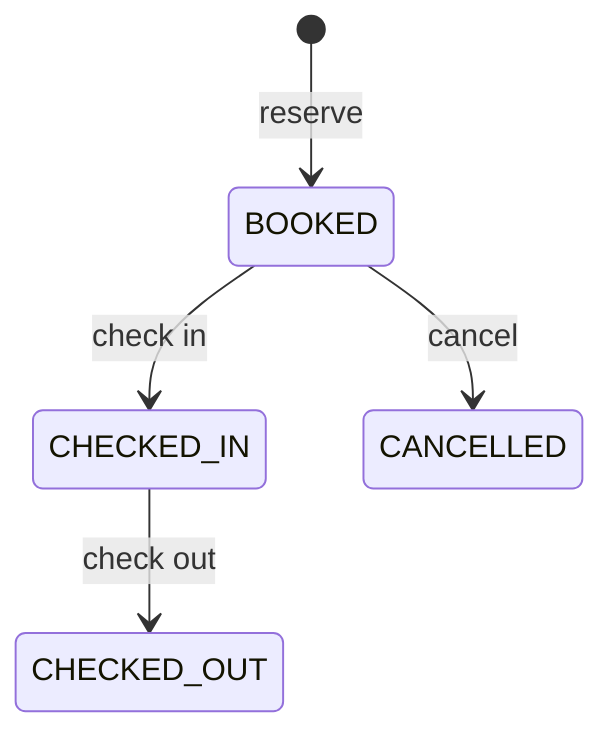

# Hot Desk

Office desk reservations with permanent seat assignments and attendance history.
Built with Angular 21, Symfony 7.4 / PHP 8.3, Doctrine ORM and PostgreSQL 18.
Symfony Messenger handles booking emails asynchronously.

## Run locally

The current setup uses the shared `/var/www/docker-environment` PHP service.
Place this checkout at `/var/www/sites/hot-desk`. The shared service must mount
`/var/www/sites` at `/srv/sites`, join `docker-environment_default`, and route
`hot-desk.localhost` to this project's `public/` directory. Mailpit is available
as `mailer` on that network.

Requirements: Docker Compose, Node 22.12+ (22.x), npm, Python 3 and the shared
PHP service. PHP needs `pdo_pgsql`, `intl`, `mbstring`, `ctype`, `iconv` and the
normal Symfony extensions.

The shared PHP Dockerfile needs `libpq-dev` in its apt dependencies and
`pdo_pgsql` in its `docker-php-ext-install` list. These additions have been made
to the local shared image definition. For an older running image:

```bash
docker exec docker-environment-frankenphp-1 install-php-extensions pdo_pgsql
docker restart docker-environment-frankenphp-1
```

The restart briefly affects other PHP projects in that container. A later image
rebuild must retain the Dockerfile additions above.

From this repository:

```bash
bash scripts/setup.sh
```

Setup generates local secrets, starts PostgreSQL, installs dependencies, migrates
the development/test databases, creates demo data only in an empty user database,
and builds Angular. Open **http://hot-desk.localhost**.

Generated passwords are in `.local/accounts.json` (mode 600). Demo accounts:

| Account | Role |
| --- | --- |
| `admin@hotdesk.test` | Administrator |
| `anna@hotdesk.test` | Team member |
| `piotr@hotdesk.test` | Team member |

The demo office has twelve desks and working hours of 08:00–18:00 in Europe/Warsaw.
Administrators can change the hours when there are no current/future bookings.

The PHP helper accepts `PHP_CONTAINER` and `PHP_PROJECT_DIR` overrides. For a
local PHP installation, set `PHP_EXECUTION=local` and configure a reachable
`DATABASE_URL` in `.env.local`. The default database hostname is on Docker's network.

## Development and email worker

```bash
npm --prefix frontend run build
bash scripts/php.sh bin/console doctrine:migrations:migrate --no-interaction
bash scripts/worker.sh
```

Rebuild Angular after frontend changes. PHP serves its output from `public/app`.
The worker consumes booking notifications; stop it with Ctrl+C. Inspect delivered
emails at **http://mail.localhost**. Failed notifications can be inspected/retried:

```bash
bash scripts/php.sh bin/console messenger:failed:show
bash scripts/php.sh bin/console messenger:failed:retry
```

PostgreSQL data persists in the `hot-desk_postgres_data` volume. Stop it with
`docker compose -p hot-desk -f compose.dev.yaml down`. Adding `-v` deletes its data.

## Main rules

- Reserve today or tomorrow, interpreted in the office timezone. All calendar
  days are initially bookable, including weekends. Office hours are configurable.
- One active desk reservation per person/day and one per desk/day. Cross-office
  reservations also check actual time overlap.
- A permanent seat limits its owner to that desk and excludes other users.
  Assignments do not create reservations automatically.
- Check in on the reserved day during office hours. Check-in is a button;
  automatic Wi-Fi detection is not implemented.
- Cancel before check-in, or check out after check-in. Both release the desk for
  the remainder of the day, subject to permanent assignments.
- Past reservations and events remain in history. An elapsed reservation does
  not generate a fictional check-out event.
- Resolve conflicting bookings/assignments before moving or deactivating resources.
  Resources referenced by history cannot be deleted. The last active admin is protected.



## Architecture

Controllers map JSON to validated request DTOs. Services enforce business rules
and transactions; the repository queries Doctrine entities. Response mappers
select public fields and never serialize password hashes.

Each successful action writes an append-only `audit_event`: actor, `event_name`,
`event_date`, `event_type`, and JSONB `event_data`. Booking data identifies the
owner, desk, day, state and event ID. Users see their own timeline; admins can
filter the full history. Administrative changes and assignments are logged too.

Booking/admin writes share a PostgreSQL transaction advisory lock to prevent
assignment/booking races. This serializes writes, which is sufficient for this
project's scale. Partial unique indexes additionally protect active daily bookings.
The booking change, event and queued notification commit or roll back together.

The worker sends an immutable event snapshot and records processed IDs to avoid
normal duplicate handling. If SMTP delivery succeeds and the process crashes
before committing that marker, retrying can still send a duplicate email.

Authentication uses Symfony Security, hashed passwords and server-side sessions
with HttpOnly/SameSite cookies. Mutations require a CSRF header, including login.
Admin routes require `ROLE_ADMIN`; disabled users lose access on their next request.
Login attempts are rate limited. Use HTTPS when deploying outside local development.

See [ERD](docs/data-model.md), [OpenAPI](docs/openapi.yaml) and the authenticated
`/api/openapi.json` endpoint.

## Tests and formatting

Use VS Code **Run Test Task → test**, or the same command directly:

```bash
bash scripts/test.sh
```

The two test files contain 12 policy tests and 7 API integration tests. They use
`hotdesk_test` and reset its fixtures. Never use a test database containing data
to keep.

Use the VS Code **format** task, or:

```bash
bash scripts/format.sh
npm --prefix frontend run format:check
bash scripts/php.sh vendor/bin/php-cs-fixer fix --dry-run --diff
```

See [coding standards](docs/coding-standards.md). Credentials, runtime data,
dependencies and build output are excluded from Git.

## Delivery

[Requirements coverage](docs/requirements.md) maps the project to the course
criteria. [Demo outline](docs/demo.md) describes a 3–5 minute presentation.

Standalone Compose packaging is the next phase. `compose.dev.yaml` currently
starts the project database and uses the existing shared PHP network. Final
submission still requires a repository URL, a reviewed final commit/tag and a
recorded demonstration.
