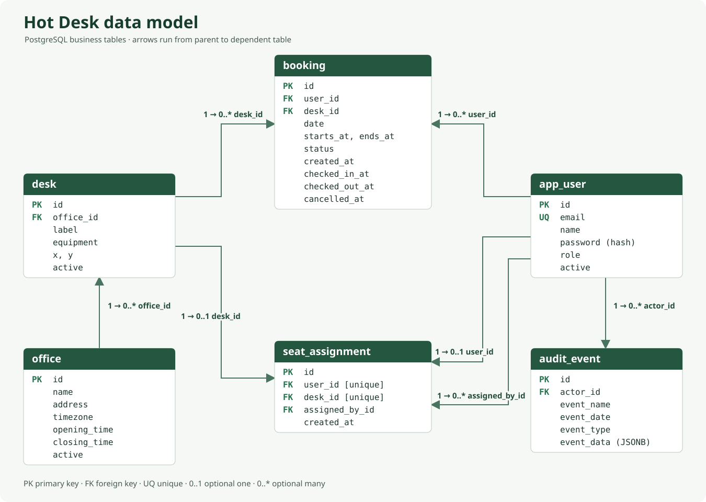
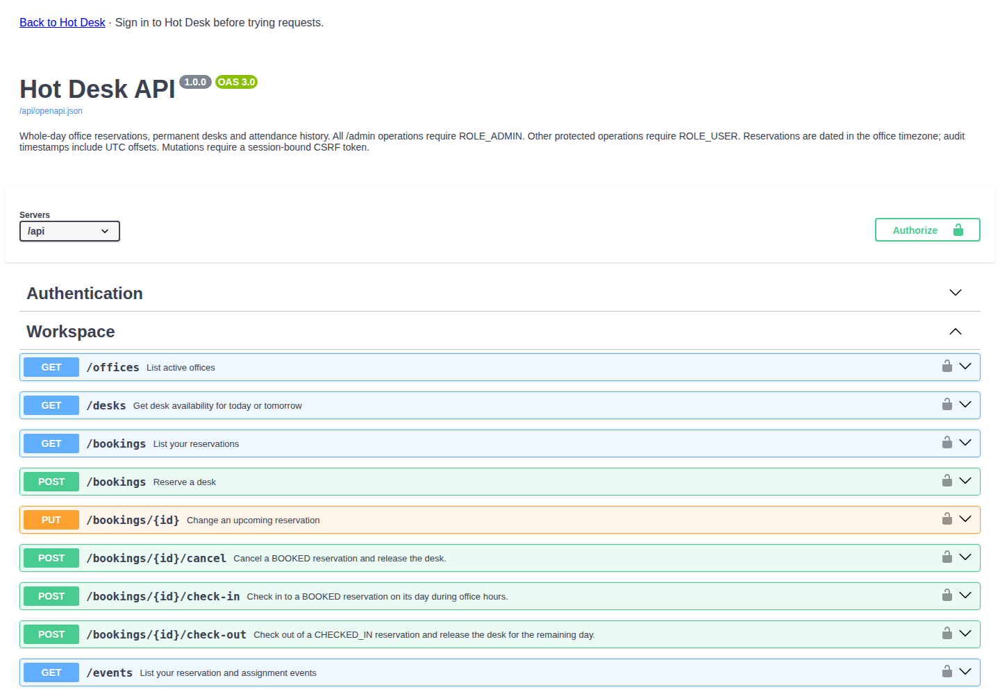
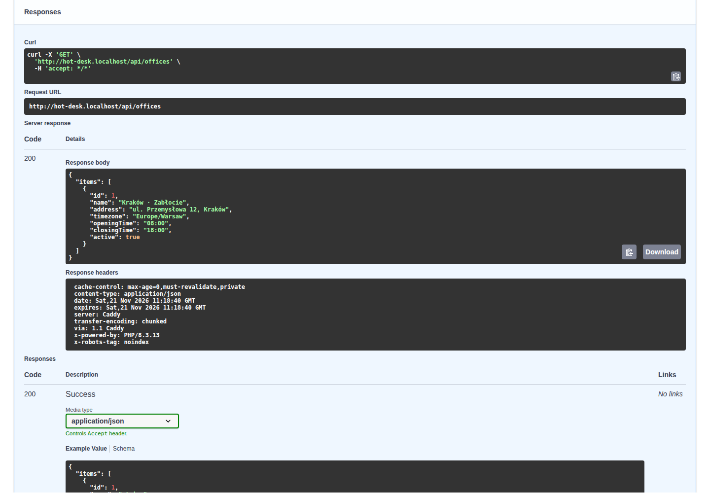

# Hot Desk

Hot Desk is an office desk booking app. Team members use a desk map to find a
workspace, reserve it, and check in and out. Administrators manage the office
layout, accounts, and permanent seat assignments.

| Team member | Administrator |
| --- | --- |
| Find a desk by office, date, or equipment | Create and edit offices, desks, and accounts |
| Reserve, edit, or cancel a booking | Assign a permanent desk to a member and remove the assignment |
| Check in, check out, and view personal activity | Review reservations and filter the audit log |

## Run locally

Install Docker with the Compose plugin and OpenSSL. From the repository root,
create the local environment file **once**:

```sh
(umask 077
  printf 'HOT_DESK_APP_SECRET=%s\n' "$(openssl rand -hex 32)"
  printf 'HOT_DESK_DB_PASSWORD=%s\n' "$(openssl rand -hex 24)"
) > .compose.env
```

Keep this file for subsequent runs because its password initializes the
PostgreSQL volume. Git ignores the file. Build and start the app:

```sh
docker compose --env-file .compose.env up --build -d --wait
```

The init service applies the Doctrine migrations and creates the demo office
and accounts on first boot. Angular is built inside Docker, so the standalone
setup needs no host Node.js or PHP installation.

| Address | Use |
| --- | --- |
| <http://localhost:8080> | Hot Desk |
| <http://localhost:8025> | Mailpit inbox for booking notifications |

Get the generated demo passwords:

```sh
docker compose --env-file .compose.env exec backend cat .local/accounts.json
```

Sign in as `admin@hotdesk.test` to manage the workspace or as
`anna@hotdesk.test` or `piotr@hotdesk.test` to try the member workflow.
The seeded Kraków office is open **08:00–18:00 Europe/Warsaw**. To demonstrate
check-in outside that window, edit the demo office hours before booking.

Set `HOT_DESK_PORT` or `HOT_DESK_MAIL_PORT` in `.compose.env` if a port is already
in use. Stop the services with
`docker compose --env-file .compose.env down`. The database and demo credentials
persist in Docker volumes.

## Booking rules

1. Reserve a desk for today or tomorrow in the office's time zone. The booking
   covers the office's working day.
2. A desk and a person can each have only one active booking per day. The app
   also checks overlapping office hours across time zones.
3. A permanent assignment reserves the **right to book** that desk for its
   assignee. The assignee can book only that desk, and other members cannot book
   it while the assignment is active.
4. A booking can be edited or cancelled before check-in. Check-in opens during
   office hours on the booking date. Cancelling or checking out frees the desk,
   subject to permanent assignments. The audit history retains each booking and attendance change.

## How it works

**Stack:** Angular 21, Symfony 7.4 on PHP 8.3, Doctrine ORM, and PostgreSQL 18.
Symfony Messenger processes notification emails in a separate worker.

Angular sends a JSON request to a Symfony controller. A request DTO validates
the input, the service checks the business rules, and Doctrine reads or writes
PostgreSQL. Symfony Security uses server-side sessions and the USER and ADMIN
roles. A CSRF token is required for mutations, and the API returns structured
errors with field details where available.

For a booking change, the service writes the booking, audit event, and notification
queue entry in one transaction. A PostgreSQL transaction lock coordinates
booking and assignment writes. Partial unique indexes enforce active reservations
per desk and per person. The worker sends the email separately, so a booking
doesn't wait on SMTP.

### Entity relationship diagram



The diagram shows the six business tables and their foreign keys. See the
[data model notes](docs/data-model.md) for constraints and queue tables.

### API documentation and Swagger UI

Sign in to Hot Desk, then open
[Swagger UI](http://localhost:8080/app/swagger/index.html) on the same host.
Under **Workspace**, open **GET /offices**, select **Try it out**, and click
**Execute**. Swagger uses your existing session and shows the HTTP status and
JSON response. The UI supports trying GET requests.





The [OpenAPI specification](docs/openapi.yaml) is also available at
`/api/openapi.json` after sign-in. See the
[course requirements map](docs/requirements.md), [demo outline](docs/demo.md),
and [coding standards](docs/coding-standards.md) for more project details.

## Development and tests

The optional shared PHP workflow requires the FrankenPHP service at
`/var/www/docker-environment` with `pdo_pgsql` enabled and Node 22.12 or newer
in the 22.x line. With the checkout at `/var/www/sites/hot-desk`, run:

```sh
bash scripts/setup.sh
bash scripts/test.sh
```

That workflow uses `compose.dev.yaml` and serves the app at
<http://hot-desk.localhost>. Run `bash scripts/worker.sh` in a separate terminal
for notifications. The standalone Compose setup starts its own worker.

The test command runs **12 policy tests and 7 REST API integration tests**. It
uses the separate `hotdesk_test` database and resets its fixtures. The same
command is available through VS Code's **Run Test Task**. Run
`bash scripts/format.sh` to apply PHP-CS-Fixer and Prettier.
