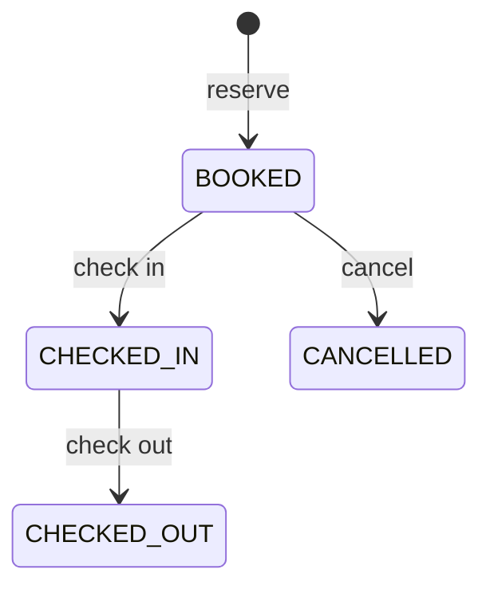

# Hot Desk

Office desk reservations with permanent seat assignments and attendance history.
Built with Angular 21, Symfony 7.4 / PHP 8.3, Doctrine ORM and PostgreSQL 18.
Symfony Messenger handles booking emails asynchronously.

## Run with Docker Compose

From a fresh clone, with Docker and the Compose plugin installed, run:

```sh
(umask 077
  printf 'HOT_DESK_APP_SECRET=%s\n' "$(openssl rand -hex 32)"
  printf 'HOT_DESK_DB_PASSWORD=%s\n' "$(openssl rand -hex 24)"
) > .compose.env
docker compose --env-file .compose.env up --build -d
```

Generate `.compose.env` once and keep it for subsequent runs. The password is
used to initialize PostgreSQL. The file is ignored by Git.

Open <http://localhost:8080>. Compose builds Angular and the Symfony backend,
migrates PostgreSQL and seeds a demo office on first boot. It also runs the
notification worker. To retrieve the generated demo credentials, run:

```sh
docker compose --env-file .compose.env exec backend cat .local/accounts.json
```

Use `admin@hotdesk.test` for administration and `anna@hotdesk.test` or
`piotr@hotdesk.test` for the member views. The demo office is open
08:00–18:00 Europe/Warsaw. Check-in can be demonstrated during those hours,
or after changing the demo office hours before making a booking.

Booking notifications appear in Mailpit at <http://localhost:8025>. If either
port is in use, set `HOT_DESK_PORT` or `HOT_DESK_MAIL_PORT` in `.compose.env`.
Run `docker compose --env-file .compose.env down` to stop the stack.
The database and demo credentials persist in Docker volumes.

## Development on the shared PHP environment

The optional `bash scripts/setup.sh` workflow uses the local
`/var/www/docker-environment` FrankenPHP service with `pdo_pgsql` enabled and
Node 22.12+ on the host. Put the checkout at `/var/www/sites/hot-desk` and open
<http://hot-desk.localhost>. Run `bash scripts/worker.sh` in a separate terminal
for notifications. This workflow uses `compose.dev.yaml` and its own database.

## Main rules

- Reserve today or tomorrow, interpreted in the office timezone. All calendar
  days are initially bookable, including weekends. Office hours are configurable.
- One active desk reservation per person/day and one per desk/day. Cross-office
  reservations also check actual time overlap.
- A permanent seat limits its owner to that desk and excludes other users.
  Assignments do not create reservations automatically.
- Check in on the reserved day during office hours. Check-in is a button;
  automatic Wi-Fi detection is not implemented.
- Cancel before check-in, or check out after check-in. Both release the desk for
  the remainder of the day, subject to permanent assignments.
- Past reservations and events remain in history. An elapsed reservation does
  not generate a fictional check-out event.
- Resolve conflicting bookings/assignments before moving or deactivating resources.
  Resources referenced by history cannot be deleted. The last active admin is protected.



## Architecture

Controllers map JSON to validated request DTOs. Services enforce business rules
and transactions; the repository queries Doctrine entities. Response mappers
select public fields and never serialize password hashes.

Each successful action writes an append-only `audit_event`: actor, `event_name`,
`event_date`, `event_type`, and JSONB `event_data`. Booking data identifies the
owner, desk, day, state and event ID. Users see their own timeline; admins can
filter the full history. Administrative changes and assignments are logged too.

Booking/admin writes share a PostgreSQL transaction advisory lock to prevent
assignment/booking races. This serializes writes, which is sufficient for this
project's scale. Partial unique indexes additionally protect active daily bookings.
The booking change, event and queued notification commit or roll back together.

The worker sends an immutable event snapshot and records processed IDs to avoid
normal duplicate handling. If SMTP delivery succeeds and the process crashes
before committing that marker, retrying can still send a duplicate email.

Authentication uses Symfony Security, hashed passwords and server-side sessions
with HttpOnly/SameSite cookies. Mutations require a CSRF header, including login.
Admin routes require `ROLE_ADMIN`; disabled users lose access on their next request.
Login attempts are rate limited. Use HTTPS when deploying outside local development.

See [ERD](docs/data-model.md), [OpenAPI](docs/openapi.yaml) and the authenticated
`/api/openapi.json` endpoint.

## Tests and formatting

Use VS Code **Run Test Task → test**, or the same command directly:

```bash
bash scripts/test.sh
```

The two test files contain 12 policy tests and 7 API integration tests. They use
`hotdesk_test` and reset its fixtures. Never use a test database containing data
to keep.

Use the VS Code **format** task, or:

```bash
bash scripts/format.sh
npm --prefix frontend run format:check
bash scripts/php.sh vendor/bin/php-cs-fixer fix --dry-run --diff
```

See [coding standards](docs/coding-standards.md). Credentials, runtime data,
dependencies and build output are excluded from Git.

## Delivery

[Requirements coverage](docs/requirements.md) maps the project to the course
criteria. [Demo outline](docs/demo.md) describes a 3–5 minute presentation.

The course submission also requires a repository URL, a final commit SHA or tag,
and a recorded demonstration.
