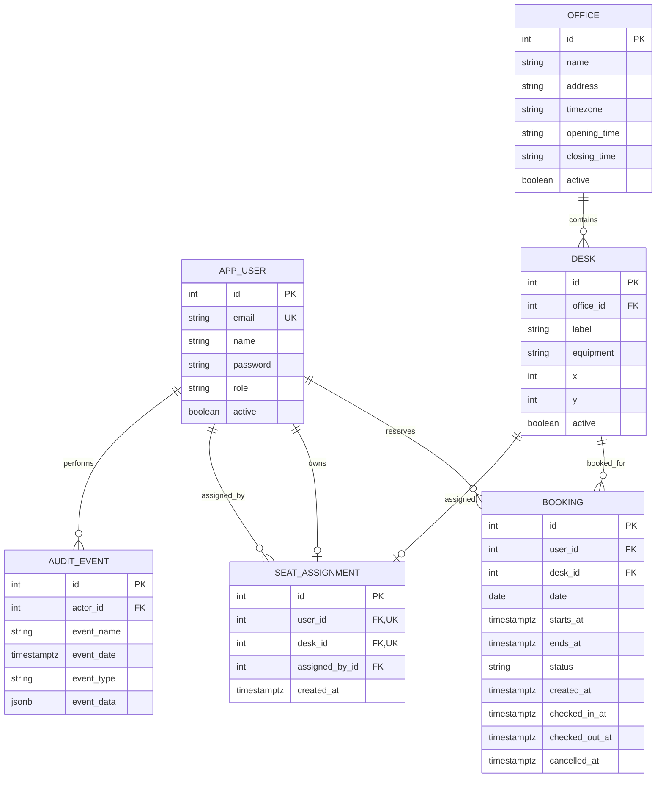

# Data model

`desk(office_id, label)` is unique. Partial indexes on `booking(desk_id, date)`
and `booking(user_id, date)` are unique while status is `BOOKED` or `CHECKED_IN`.
The reserved date is a calendar date in the office timezone. The start/end
instants capture that day's office hours for overlap checks and history.

`messenger_messages` stores pending/retry/failed notifications.
`notification_delivery` records event IDs already sent by the worker. These are
infrastructure tables, separate from the six core business entities.
